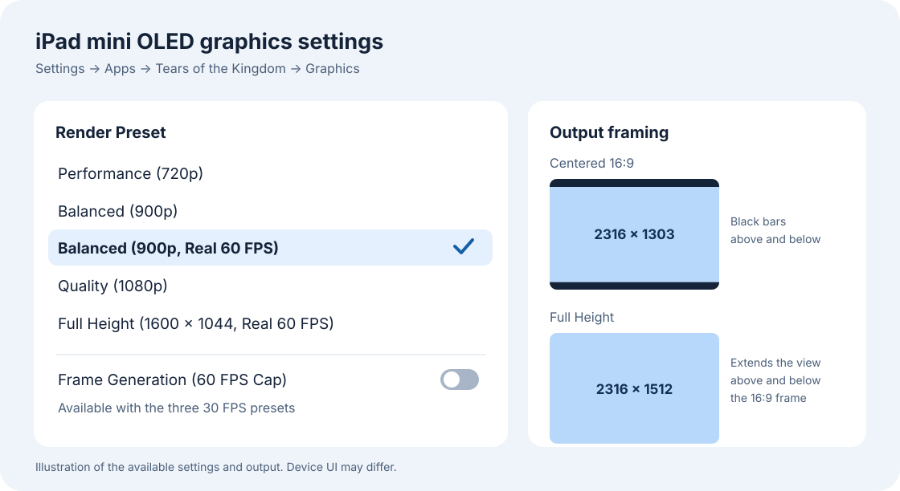

# Tears of the Kingdom 1.2.1 on iPad mini OLED

An experimental Apple silicon port built locally from your own Switch files. This guide covers the 1.2.1 OLED configuration. It uses the MacNativeGames build tools and the revision below.

This source patch is based on [MacNativeGames revision `4fdda415`](https://github.com/ly05010419/MacNativeGames/tree/4fdda41562a1c783fb1aacd18891ad4f48b8c360). The package includes the OLED graphics presets, Stats, shader precompilation, and controller support. The personal cheat catalog, captured motion-replay data, and device-specific shader caches are excluded. Performance below was measured on earlier device builds in this project. The public source patch compiled for iPadOS with locally prepared inputs. A clean first build and a physical-device run of this exact patch are still pending.



Keep the game, update, console keys, fonts, saves, and generated shader data on your own devices. A locally built IPA can contain rewritten game code even when the game image is transferred separately. Keep that IPA and the signed app private as well.

## Build and install

1. Use an Apple silicon Mac with macOS 26 or newer, full Xcode 26 or newer with the iOS platform installed, Homebrew, and an iPad mini OLED running iPadOS 26 or newer. The OLED device build was made with Xcode 27. Keep the work folder and IPA output on the same APFS volume. Plan for roughly 80 GB free on the Mac for build and signing copies, and about 25 GB on the iPad. The game image alone takes about 17 GB. [MacNativeGames requirements](https://github.com/ly05010419/MacNativeGames/blob/main/docs/install.md)
2. Have your own uncompressed Tears of the Kingdom base game (1.0.0), the matching 1.2.1 update, and your console's `prod.keys`. An XCI base can supply the system fonts. With an NSP base, provide your own firmware or locally extracted shared fonts as instructed by the builder. Put those inputs outside the source checkout.
3. Install the dependencies and apply the OLED patch in Terminal.

   ```sh
   brew install opus libvpx python@3.14 xcodegen cmake ninja
   xcodebuild -version
   xcodebuild -downloadComponent MetalToolchain
   xcrun --sdk iphoneos metal --version

   git clone https://github.com/Koulinski/totk-ipad-mini-oled.git
   git clone https://github.com/ly05010419/MacNativeGames.git
   cd MacNativeGames
   git switch --detach 4fdda41562a1c783fb1aacd18891ad4f48b8c360
   git apply --check ../totk-ipad-mini-oled/ipad-mini-oled.patch
   git apply ../totk-ipad-mini-oled/ipad-mini-oled.patch
   ```

4. In Xcode, sign in with your own Apple Account. Connect the iPad with a USB data cable, unlock it, and pair it with the Mac. On the iPad, open **Settings → Privacy & Security → Developer Mode** and follow the restart and confirmation prompts. Pairing makes that menu available. Use a development profile for your iPad that supports the app's Increased Memory Limit and Extended Virtual Addressing capabilities. [Apple's device setup guide](https://developer.apple.com/documentation/xcode/enabling-developer-mode-on-a-device) · [Apple's Xcode signing guide](https://developer.apple.com/documentation/xcode/running-your-app-on-simulated-or-physical-devices)
5. Build the local 1.2.1 IPA. Replace the quoted example paths with your own paths. The first build prepares the resources and shaders and can take a while. Run each command only after the previous one succeeds.

   ```sh
   base="$HOME/Games/your-base-game.xci"
   update="$HOME/Games/your-update-1.2.1.nsp"
   keys="$HOME/Games/prod.keys"
   work="$HOME/Games/TOTK-OLED-Local"
   ipa="$work/TOTK-1.2.1-local.ipa"

   python3.14 build_app.py "$base" --keys "$keys" --update "$update" \
     --platform ios --work "$work" --out "$ipa" --no-shader-reminder
   ```

   Use the actual `.nsp` or `.nsz` update filename. For an NSP base, also pass `--firmware "/path/to/your/unpacked-firmware"` or `--shared-fonts "/path/to/your/extracted-fonts"`. The builder makes the Full Height overlay and shader seed locally. The IPA contains local game data and is for your own installation.

6. Install the app using the connected iPad's name and a bundle identifier under your signing team. Keep that identifier and team the same for future updates so the device can keep the app's data. Before updating an existing install, close it and back up both save profiles and the shader cache.

   ```sh
   python3.14 games/totk/ios/tools/install_device.py "$ipa" --device "Your iPad name"
   ```

   If you have more than one signing team, pass `--team YOUR_TEAM_ID`. The script chooses a stable, team-specific bundle ID unless you set `--bundle-id`. It checks both memory entitlements and the registered device before signing and installing. Provisioning expires according to your profile. Run the same command to renew.

7. Open the app and let initial shader preparation finish. Open iPad **Settings → Apps → Tears of the Kingdom → Graphics** to choose a preset, then fully quit the game and reopen it. For the tested 60 FPS profile, choose **Balanced (900p, Real 60 FPS)**.

## Graphics and controls

| Render preset | Scene resolution | Output on the OLED mini | Frame target |
| --- | --- | --- | --- |
| Performance (720p) | 1280 × 720 | Centered 16:9 | 30 real FPS, with optional frame generation |
| Balanced (900p) | 1600 × 900 | Centered 16:9 | 30 real FPS, with optional frame generation |
| Balanced (900p, Real 60 FPS) | 1600 × 900 | Centered 16:9 | 60 real FPS |
| Quality (1080p) | 1920 × 1080 | Centered 16:9 | 30 real FPS, with optional frame generation |
| Full Height (1600 × 1044, Real 60 FPS) | 1600 × 1044 | Full 2316 × 1512 display | 60 real FPS, experimental |

MetalFX spatial scaling is enabled for these presets. The centered presets use a 2316 × 1303 game picture inside the 2316 × 1512 display, with black bars above and below. Full Height extends the camera's vertical view while keeping the horizontal view. These are render targets. Frame rate depends on the scene, shader cache, and device conditions.

**Frame Generation (60 FPS Cap)** starts off. With a compatible 30 FPS preset, it can insert frames between real frames for up to 60 displayed FPS. The two Real 60 FPS presets turn it off. Selecting Full Height on an unrecognized device falls back to Balanced (900p, Real 60 FPS).

**Saves** has a **Use Copied Mac Saves** switch. If a separate Mac save profile has already been copied into the app, this switch selects it on the next launch. The iPad profile retains its own progress. The switch alone does not import a save.

**Game language** can follow the system or use Traditional Chinese, Simplified Chinese, English, Japanese, German, Spanish, French, Italian, Dutch, Russian, or Korean. Relaunch after changing it.

Tap the gameplay view to reveal the toolbar. The buttons hide again after about four seconds of inactivity. An open menu or active shader build keeps its controls available.

| Toolbar button | Options |
| --- | --- |
| Shaders | Start or stop **Build Shaders** and view its progress. You can hide the panel while work continues. This precompiles known recipes. New areas can still encounter new pipelines. |
| Stats | Toggle FPS, resolution and MetalFX, display frame time (P95), CPU submit time, GPU render time (P95), and app memory. The selections persist. Clear all six to hide the readout. |

Touch controls are available. A DualSense was tested on the OLED mini, including gyro aiming. USB-C GameSir gyro still needs a device test.

## Measured on the iPad mini OLED

The earlier 1.2.1 OLED test used the Balanced (900p, Real 60 FPS) preset, MetalFX, and frame generation off. The Depths route was walked by hand, so the samples cover different lengths. P95 is the display interval at or below which 95% of intervals fell.

| Depths route sample | Displayed FPS | Display interval P95 | Display gaps over 50 ms | Peak sampled app memory |
| --- | ---: | ---: | ---: | ---: |
| 40.6 seconds after building shaders | 59.30 | 16.67 ms | 7 | 3.25 GiB |
| 53.0 seconds on a repeat in the same session | 59.73 | 16.67 ms | 3 | 3.27 GiB |

The longest gaps were about 83 ms in the first sample and 133 ms on the repeat. Six of the first run's seven gaps and all three gaps on the repeat coincided with shader or pipeline creation. In a separate 900p comparison, the tester preferred real 60 FPS to 30 FPS with frame generation. An earlier higher-resolution real-60 test ran around 36–45 FPS in parts of its route and occasionally dropped to around 20 FPS. Full Height gameplay was checked on the OLED mini. Its sustained frame rate and memory use still need a matched device run.

## Problems found and work remaining

- **Cold shaders.** The first visit to a scene may hitch while Metal builds a new pipeline. A repeat route was smoother in the same session. Cache behavior after relaunch and across more areas still needs testing.
- **Rendering.** The reported waterfall flicker and unexpected red patches in the Depths were fixed at the tested locations. Full Height still needs checks for projected world labels, scope framing, and the transition after cutscenes. The scope and opening-film framing fixes were checked on Mac and compiled for iPad. They still need an iPad run.
- **Frame generation.** Equipment can shimmer or ghost during movement. The public patch caps generated output at 60 FPS. The motion-replay experiment remains separate and uses locally captured data. Pacing and quality during walking, jumps, attacks, and fast camera turns remain open.
- **Performance.** A separate Mac trace found a mesh decode job that used about 63 ms of CPU time. Two small decoder changes showed no measurable gain. Test more scenes on iPad, including long sessions, thermals, and memory pressure.
- **Device validation.** Opening audio sync, DualSense gyro, and Full Height gameplay were checked on the OLED mini. The newer Stats menu, its persistence, and overlay clearance around display corners still need a live check. HDR and ray-traced reflections are experiments.

For installation failures, confirm the device is paired and unlocked, Developer Mode is on, and your development profile matches the app's bundle identifier, capabilities, and iPad. If the builder reports a module mismatch, verify that your update is exactly 1.2.1. If the app reaches the game but stutters, note the preset, area, whether the shader cache was warm, and whether frame generation was on. Share the preset and observed behavior in bug reports. Keep local game data and account details private.

The patch is distributed under the MIT license with upstream notices preserved. Tears of the Kingdom and Nintendo Switch are trademarks of Nintendo. This project is independent of Nintendo.
